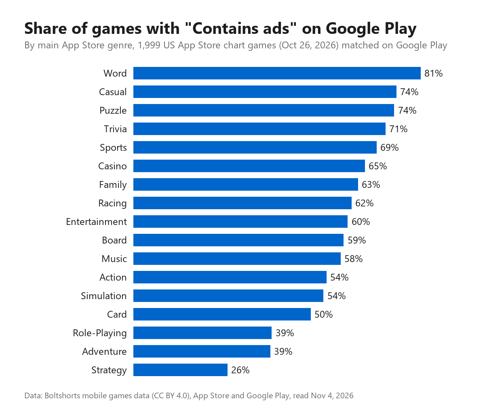

# What 2,894 App Store chart games say about ads, prices and download size, genre by genre

When you plan a mobile game, the questions that shape the business come early. Free with ads, or paid? How big can the download get before it hurts? Is your genre one where players expect ads, or one where ads stand out?

Most public answers come from market reports behind a paywall or from datasets that cover one store and are years old. So we read the store pages ourselves. We took every game in the US App Store top charts for iPhone on October 26, 2026 (Top Free, Top Paid and Top Grossing, for all games and for each game genre) and matched each one to its Google Play page. That came to 2,894 games. Here is what the pages say.

## How we read them

- App Store facts (price, rating, number of ratings, download size, genre) come from the US App Store and Apple's iTunes Search API.
- Google Play facts (downloads, the "Contains ads" and "In-app purchases" labels) come from the US Google Play pages. A game counts as the same game on both stores only when developer and title agree, or when the package name equals the iOS bundle id. 1,999 of the 2,894 games passed that check. When we were not sure, we left Google Play blank instead of guessing.
- Genre is the game's main App Store category.

Two limits worth saying up front. The ads and in-app purchase labels are what developers declare to Google, not a measurement of how many ads a player sees. And this is one day of US charts, so it describes what is selling now, not every game ever made.

## Ads are the default, even at the top of Top Grossing

57% of the chart games we matched on Google Play carry the "Contains ads" label. That is expected for free games: 80% of the games in the Top Free charts have it. In the Top Paid charts it is 11%.

The more interesting number is Top Grossing. These are the games that make the most money from purchases, the ones you might expect to protect the experience. 69% of them carry the "Contains ads" label too (978 games matched). At this level, ads and in-app purchases are not two business models. They are one, stacked.

## The genre gap is bigger than the free/paid gap

Here is each genre with about 100 chart games or more:

| Genre | Games | "Contains ads" on Google Play | Free on iPhone | Median iPhone download |
|---|---|---|---|---|
| Word | 106 | 81% | 59% | 204 MB |
| Casual | 214 | 74% | 72% | 337 MB |
| Puzzle | 227 | 74% | 70% | 338 MB |
| Trivia | 99 | 71% | 58% | 97 MB |
| Sports | 148 | 69% | 70% | 357 MB |
| Casino | 129 | 65% | 70% | 234 MB |
| Family | 120 | 63% | 55% | 259 MB |
| Racing | 101 | 62% | 54% | 467 MB |
| Board | 128 | 59% | 59% | 312 MB |
| Music | 134 | 58% | 59% | 200 MB |
| Action | 172 | 54% | 58% | 457 MB |
| Simulation | 243 | 54% | 67% | 404 MB |
| Card | 152 | 50% | 61% | 292 MB |
| Adventure | 143 | 39% | 47% | 698 MB |
| Role-Playing | 134 | 39% | 64% | 585 MB |
| Strategy | 176 | 26% | 48% | 342 MB |
| **All chart games** | **2,894** | **57%** | **61%** | **318 MB** |

Word, casual and puzzle games sit near three quarters or more. Strategy sits near a quarter, and role-playing and adventure games near 40%. Strategy is also the genre where paying up front is most common: 52% of strategy games in the charts cost money on the App Store.

Read this as a map of player expectations. A word game without ads is unusual, and that can be a selling point. A strategy game with rewarded videos is unusual too, and players in that genre may notice.

## Size: the median is 318 MB, and genre explains most of the spread

The median download on iPhone is 318 MB. 942 games fit under 200 MB, and 392 need 1 GB or more. The biggest in the charts that day was Monster Hunter Stories at about 4 GB.

Genre explains most of it. The median trivia game is 97 MB and the median word game 204 MB. The median adventure game is 698 MB and the median role-playing game 585 MB. If you are making a small puzzle or word game, the bar to look lean is low: half of the word games in the charts are over 204 MB, and half of the puzzle games over 338 MB.

## Almost nobody is ads-free and purchase-free

Only 367 of the 1,999 games on Google Play (18%) show neither label. 334 of those charge up front on Android. Just 33 are free with no ads and no in-app purchases. "Free, no ads, nothing to buy" exists, but it is close to a rounding error in the charts.

## Ratings do not separate genres much

Median App Store ratings run from 4.52 (music) to 4.73 (puzzle). Store ratings are compressed near the top, so a 4.6 versus a 4.7 says little about a genre. The number of ratings says more about reach: the median puzzle game in the charts has about 18,700 ratings, the median music game about 660.

## What we take from it

- Pick your ad policy by genre, not by habit. In word and puzzle games, ads are what players expect; in strategy and RPGs, they are what players notice.
- Size is a competitive fact you can look up. Compare yourself with the median of your genre, not with the whole store.
- "No ads" is a real differentiator only where most competitors have them. The data tells you where that is.

## The data

Everything above comes from one open table, free under CC BY 4.0 as CSV and JSON: https://boltshorts.com/data/ (mirror: https://github.com/phescobbar/mobile-games-data). The full table is wider than this post: 8,055 games, because it also includes other games with 1,000+ US ratings from the same studios, so the per-genre pages on the site show slightly different shares than the chart-only numbers here. Each game has its own page, each genre a benchmark page, and dated versions of the table let you follow ratings, prices and sizes over time.

If you want a cut we did not show (one genre's paid games, one studio, one chart), the CSV has it.

*Pedro Escobar runs Boltshorts, a site of mobile game lists and open store data.*
